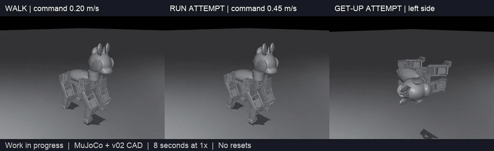
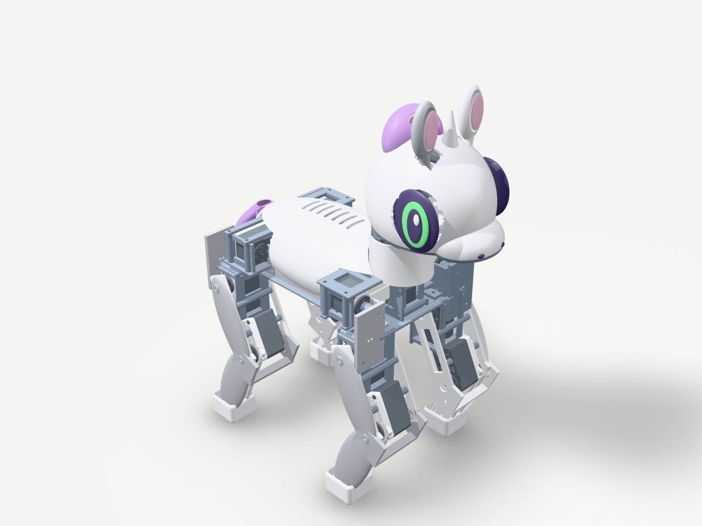
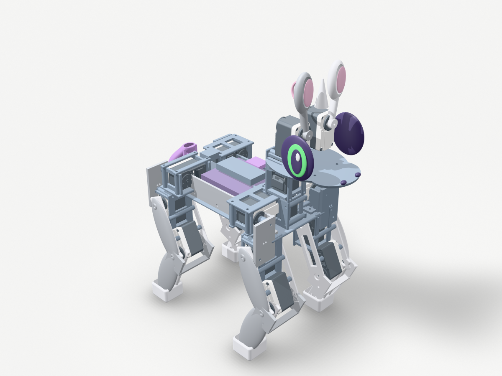
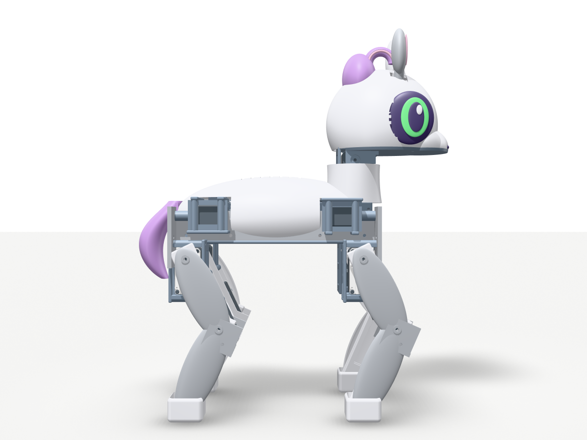
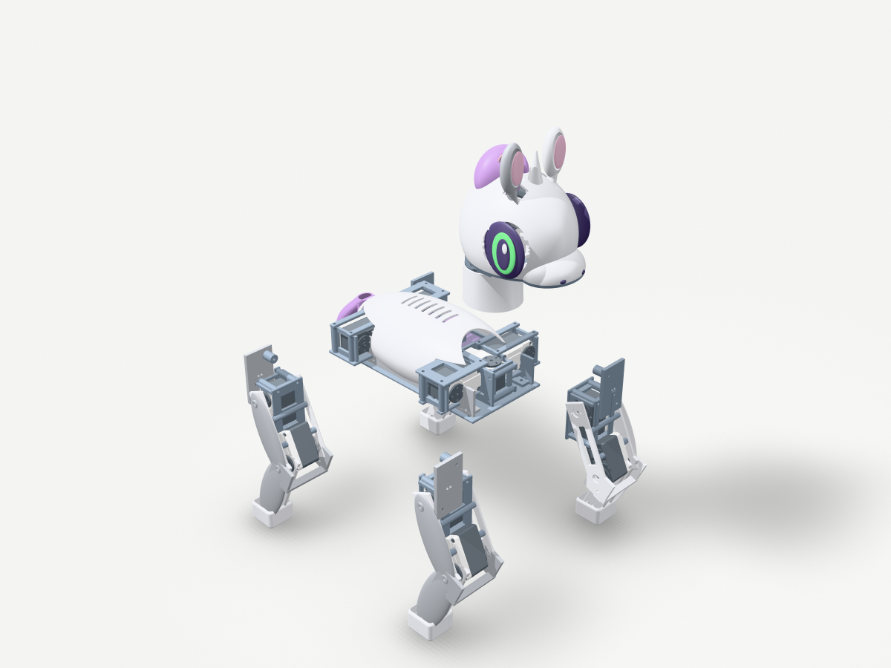

# Sweetybot2

**Inspired by [Sweetie Bot](https://github.com/sweetie-bot-project/sweetie_bot) and [Microduck](https://github.com/pollen-robotics/microduck).** An independent pony quadruped prototype with editable CAD, MuJoCo simulation and joystick-controlled PPO experiments.



*Training preview, 17 October 2026: walking / running attempt / self-righting attempt. Eight simulated seconds at 1× speed, fixed development seed, no mid-episode resets. [MP4](renders/training_preview_20261017/sweetybot2-preview.mp4) · [Checkpoint manifest](renders/training_preview_20261017/manifest.json).*

| Revision 02 assembly | Internal layout |
|---|---|
|  |  |
| Front view | Exploded assembly |
|  |  |


[CAD gallery](docs/cad-gallery.md) · [Complete CAD + preview weights](https://github.com/AlexWortega/Sweetybot2/releases/tag/v0.2.0-preview) · [Design](docs/redesign-v2.md) · [BOM](docs/bom.md) · [Training](learning/README.md)

## The robot

Revision 02 has four 3-DOF legs, head yaw/pitch and two moving ears: **16 Feetech STS3250 servos**, with twelve leg joints controlled by learned policies. The body has a 140 mm foot-centre track and a short centred neck. The estimated assembled mass is **2.71 kg**; engineering screens include a 20% mass margin. Mass and strength are estimates, not physical measurements.

The proposed electronics are a Raspberry Pi Zero 2 W, a separate IMU, two eye displays and a 3S LiFePO4 battery. Microduck informed the compact smart-servo and serviceable hardware approach; its XL330 actuators do not meet this chassis's load screen. [Actuator calculations](docs/feasibility.md) · [Power/control diagram](docs/wiring.svg).

**Digital prototype; physical hardware has not been built or validated.** The meshes, contact shapes and motor model remain approximations. Print fits, bus I/O, state estimation, servo dynamics and loaded thermal endurance need physical validation.

## Current learning results

These are intermediate development results from the best saved checkpoints at preview capture, across flat, rough, slope and step conditions at mild difficulty 0.2. The independent final evaluation has not run.

| Skill | Result | Remaining issue |
|---|---|---|
| Walking | 189/192 trials without falling (98.4%) | Heading tracking and RMS servo torque fail the full gate |
| Running | 54/96 trials without falling; 0/96 strict running successes | Repeated clean flight and stable commanded running are not learned |
| Self-righting | 0/128 completed recoveries from fallen starts | Stable get-up is not learned |

Maximum development RMS joint torque is 2.10 Nm for walking and 1.86 Nm for running, above the 1.5691 Nm sustained-torque screen. All preview policies fail their complete quality gates. Training is ongoing; these animations show the current behavior and its failures.

The PPO actor receives IMU-like signals, encoders, commands and observation history. Native MuJoCo runs at 500 Hz with policy decisions at 50 Hz. Learned policies use bounded servo position targets with no root support force or virtual support wrench. Flat ground, roughness, slopes and steps are explicit terrain families; universal terrain capability is unverified. [Protocol and limitations](docs/rl-training.md).

## Replay with a joystick

Create the separate Python 3.11 learning environment, then download and extract the preview weights:

```sh
uv venv --python 3.11 .venv-learning
uv pip install --python .venv-learning/bin/python -r learning/requirements.txt
uv pip install --python .venv-learning/bin/python pygame==2.6.1
.venv-learning/bin/python -m learning.build_native

gh release download v0.2.0-preview --repo AlexWortega/Sweetybot2 --pattern preview-policies.zip --dir dist
.venv-learning/bin/python -m zipfile -e dist/preview-policies.zip .

.venv-learning/bin/python -m learning.play --walk learning/checkpoints/walk.pt --run learning/checkpoints/run.pt --recover learning/checkpoints/recover.pt --joystick --cad
```

Hold **LB/L1** to command motion; **RB/R1** toggles walk/run. Release LB/L1 to command zero velocity. Keyboard controls: W/S forward/back, A/D sideways, Q/E turn, B walk/run, Space zero command, F fall disturbance, R explicit reset, Escape quit. Explicit resets are excluded from successful recovery. Use `--terrain rough`, `--terrain slope` or `--terrain steps` to inspect other terrain families. A physical gamepad has not yet been tested; keyboard/headless replay and input logic have been checked.

A C++17 compiler is required for the native simulator extension. On Linux, an offscreen renderer may need `MUJOCO_GL=egl` (GPU) or `MUJOCO_GL=osmesa` (software). Omit `--cad` for the lightweight visual model. Preview weights are a reproducible snapshot, not an automatically updated view of the ongoing run.

## Editable CAD and reproduction

The repository includes the parametric model factories, STEP, printable STL, link-local meshes, MuJoCo MJCF and URDF. A complete CAD ZIP, including the large assembled GLB, is attached to the [preview release](https://github.com/AlexWortega/Sweetybot2/releases/tag/v0.2.0-preview).

```sh
make setup       # Python 3.13 CAD environment from uv.lock
make test        # model and control checks
make cad         # regenerate editable parts and link visuals
make model       # regenerate descriptions and engineering reports
make render      # CAD render gallery
```

CAD uses [text-to-cad](https://github.com/earthtojake/text-to-cad) / cadgen 0.7.21. Coordinates: +X muzzle, +Y left, +Z up. CAD is in millimetres; dynamics uses metres and radians. A full cold CAD rebuild is substantial; saved exports are included for inspection.

- [Model catalog and quantities](cad/src/README.md)
- [Assembly and calibration](docs/assembly.md)
- [Mechanical review](docs/mechanical_review.md) and [physical validation](docs/validation.md)
- [Hardware command contract](docs/control-interface.md)
- [Scripted baseline results](docs/results.md): the older `simulation/run.py` crawl uses privileged state and a virtual-wrench controller. Its results are separate from the learned PPO preview above.

## Inspiration and attribution

Sweetie Bot supplies the pony identity and appearance reference. Microduck supplies hardware/design references for compact smart servos, serviceability and separation of motor control from media services. Geometry and policies here are authored for this quadruped; Microduck's CAD and biped checkpoints are not used. This project is not affiliated with or endorsed by either upstream project.

Source revisions, catalog inputs, assumptions and retained notices: [provenance](docs/provenance.md) · [third-party notices](THIRD_PARTY_NOTICES.md). No blanket license has been selected for newly authored project files; upstream material keeps its own terms.
