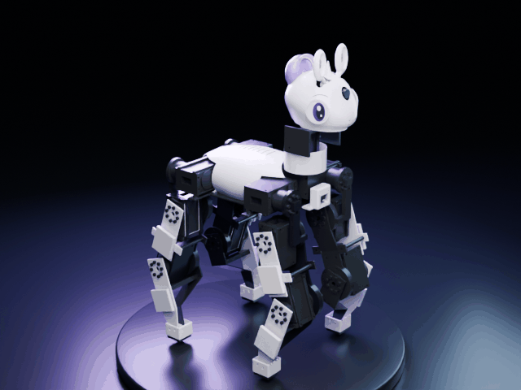
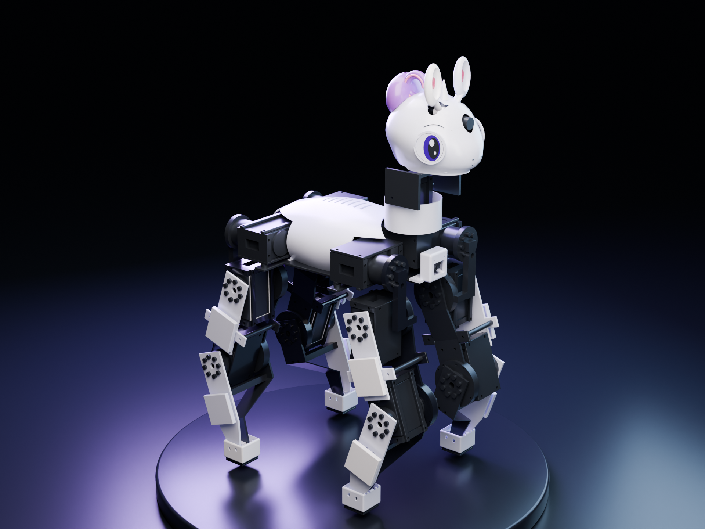
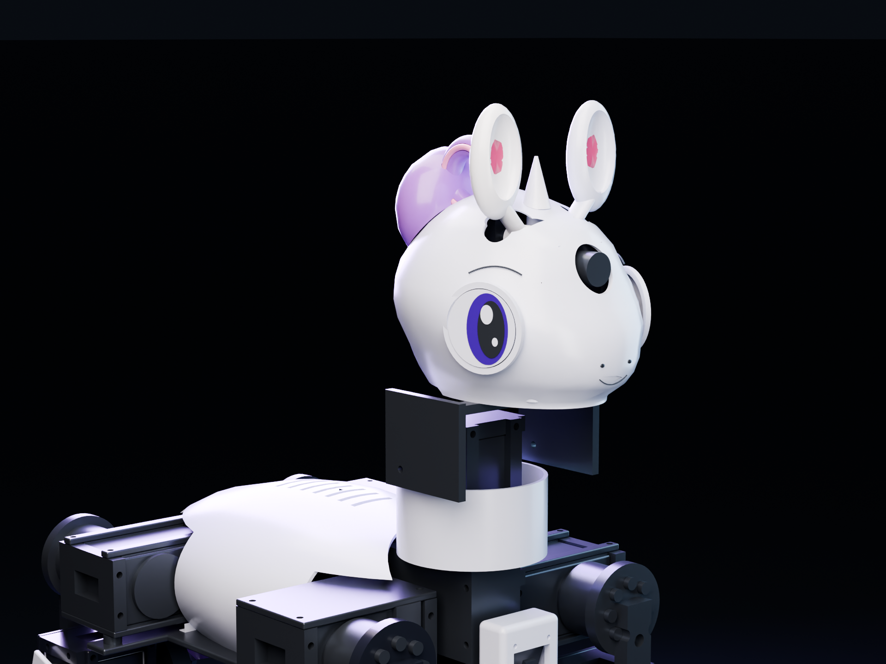
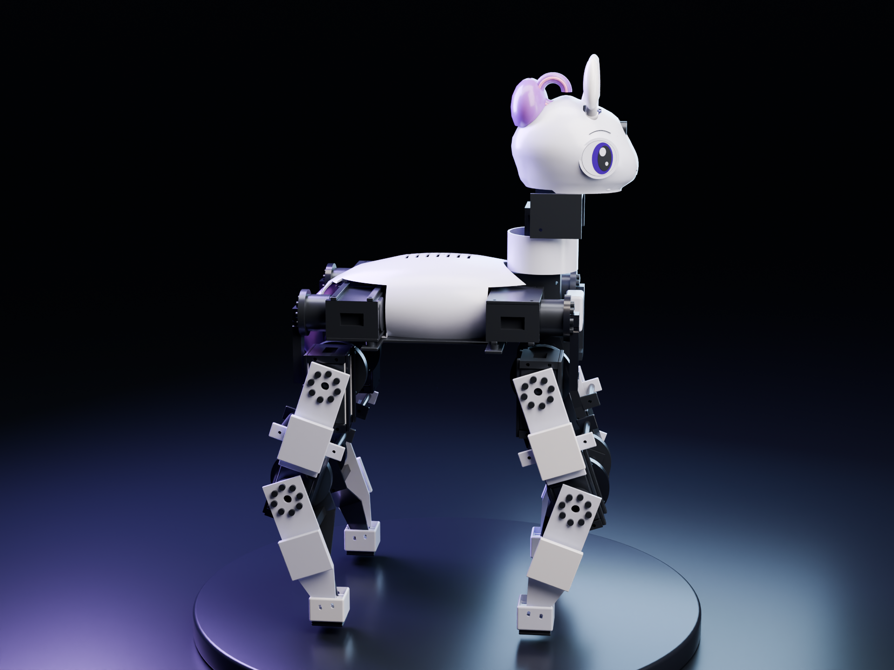

# Sweetybot2

**Inspired by [Sweetie Bot](https://github.com/sweetie-bot-project/sweetie_bot) and [Microduck](https://github.com/pollen-robotics/microduck).** Independent pony robot CAD and MuJoCo policy experiments.



*V05 CAD orbit: actual saved assembly, cosmetic surface finishes and studio lighting. This is not learned motion.*



**V05 digital mechanical + RL build:** 12 SM105BL-C001 leg motors, two STS3250 neck motors, two STS3032 ears, torso IMU, four contact hooves, chest 8×8 ToF and forehead RGB camera. Estimated mass **7.36kg**, with **8.84kg** design allowance. Physical construction, thermal endurance, firmware/drivers and trained v05 capability remain unverified.

| Head / camera | Profile |
|---|---|
|  |  |

[V05 build and scope](docs/v05.md) · [BOM](docs/bom.md) · [Wiring](docs/wiring.md) · [Mechanical gate](reports/mechanical_gate.json) · [Digital physics validation](reports/v05_validation.json)

V04 remains **withdrawn: do not fabricate it**. Its thigh/shin, knee-support and frame interferences motivated this redesign. [Original failure evidence](reports/legacy-v04-motion-audit.json) · [Withdrawn release](https://github.com/AlexWortega/Sweetybot2/releases/tag/v0.4.0-hardware-preview).

The new front/hind legs fold in opposite directions. Separate rotor planes, supported rear outputs, bearing retainers, external case clamps, rigid seating shims, axial stops and explicit flange screw heads replace the interfering layout. Body 240×136×88mm, 115/110mm leg links, 200mm foot-centre track; assembly envelope approximately **351×246×533mm**. CNC load parts use 6061; shells use PETG and tread TPU. Handed, fitted custom instances are in `cad/manufacturing/`; generic previews do not imply four identical feet/carriers.

The conditional low-voltage actuator screen gives **2.41Nm required / 3.18Nm allowance** for hip pitch/knee, with 20% mass contingency, 50% weight on one leg and 1.5 torque margin. This is an analytical screen, not a measured continuous thermal rating. [Details](docs/feasibility.md).

Digital checks include exact same-link assembly fits; full-assembly surface candidates with exact BRep confirmation at 185 operational poses; STEP round trips of all 270 saved component instances; conservative CAD-derived convex collision coverage and the matching MuJoCo pose cohort. Parent-child brackets remain collidable. Neutral targets stand for 20 seconds on flat, rough, 8° slope and 25mm steps. These deterministic checks do **not** establish learned locomotion, running, recovery, continuous clearance or arbitrary-terrain capability.

The current default trainer uses a **63-value, single-frame proprioceptive actor** and an **81-value privileged critic**, each with ELU layers **512–256–128**. The actor sees sampled IMU, all 16 joint positions/velocities, 12 previous leg actions, the velocity command, hoof contacts and sensor health. ToF, RGB and simulator truth do not enter the actor. The unchanged 197-value sensor transport and legacy 591-value policy remain available with `--observation-mode legacy`. True velocity/height/foot state helps the critic only during training. Walk/run rewards retain physical torque/overload and self-collision costs; running requires repeated sustained forward flight. A dynamics signature and explicit architecture bind checkpoints to their source and observation contracts. Solver/arena warnings stop training. [Compact policy design and preparation](docs/compact-policy.md).

**Training update, 2026-10-20:** the prior v05 campaign is complete; executor `596bf65`, output `training-microduck-rewards2`, remains archived. Legacy walking survived 48/48 final episodes each on flat/rough/steps and 26/48 on the 8° slope; recovery succeeded 8/128 times, running 0/96. No skill passed its full final gate. The new [compact revision](docs/compact-policy.md) separates exploratory continuation from champion selection, adds fixed mixed commands, smooth resampling and KL-adaptive learning rates. A separately authorized **200-hour compact campaign** on eva01 uses one training GPU at a time and a persisted absolute deadline, including setup, waits and evaluations. The old campaign is not extended. Local software/physics checks and bounded CPU preparation do not establish improved learned skill; fresh independent final seeds are reserved.

**Recovery experiment, 2026-10-21:** [intermediate supported poses](docs/recovery-waypoints.md) add one-time side, belly-support, crouch and stand milestones, bounded progress rewards and per-orientation achievement counters. Initial upright poses receive no roll credit. Full side/back starts remain in training while the curriculum advances. The same 200-hour campaign continues under its original deadline; the previous source/results remain archived. Software and neutral-physics validation passed; successful side/back recovery has not yet been demonstrated.

The same campaign also enables the [higher command-speed profile](docs/speed-targets.md): walking targets up to 0.40 m/s, running initially up to 0.65 m/s, with 0.80/1.00 m/s unlocked by survival/tracking/load checks. These are requested training targets. The evaluator's obsolete 3.5 m boundary was corrected to the current terrain limit; changed survival statistics must not be presented as policy improvement.

**Hip-roll update, 2026-10-21:** [mirrored abduction limits](docs/joint-limits.md) now allow **45° outward / 6° inward**, replacing ±8.59°. The 185-pose digital audit and 169 software tests passed. The campaign continues from verified actor weights under the original deadline, with fresh critics/optimizers and new baseline evaluations. Wide-angle load-bearing and learned back recovery remain unverified.

**Stairs and turns, 2026-10-22:** [navigation curriculum](docs/stairs-turns.md) adds five-riser ascent/descent flights (1–4 cm risers), bidirectional 180°/360° pivots and forward arcs. Actor weights are explicitly transferred into the same authorized campaign; the moving fast-mode actor initializes walking, with a separate standing recovery anchor. New per-case evaluations measure heading, stair progress, final hoof support, contacts and loads. Added tasks are training objectives, not demonstrated learned skills.

## Historical v02 policy preview


*Separate lighter v02 model: walking, running attempt and recovery attempt; no mid-episode resets. This GIF is historical and does not show v05 or establish successful running/self-righting. The original 24-hour v02 cycle is complete; its selected policies did not pass all quality gates.*

[V02 release](https://github.com/AlexWortega/Sweetybot2/releases/tag/v0.2.0-preview) · [Preview provenance](renders/training_preview_20261017/manifest.json)

## Rebuild and verify

CAD: Python 3.13 / cadgen 0.7.21. Learning: Python 3.11/3.12 / `learning/requirements.txt`. Collision build: separate Python 3.11 / `simulation/collision-requirements.txt`. Set the Makefile interpreter variables for your machine.

```sh
make setup setup-learning setup-collision
make cad collisions model
make audit test simulate
make render package
```

See [the ordered workflow and acceptance limits](docs/v05.md). The complete ZIP includes STEP/STL, assembly GLB, MuJoCo/URDF, shared sensor decoder, source and reports. Fabrication approval is outstanding: purchased shaft/horn interfaces, engagement, bearing fits, cable routing, power/BMS/fuses, fatigue and motor temperatures require a physical prototype. Hardware firmware and device commissioning have not been performed. No v05 long-training or successful learned-policy claim is made by a CPU optimizer smoke.
