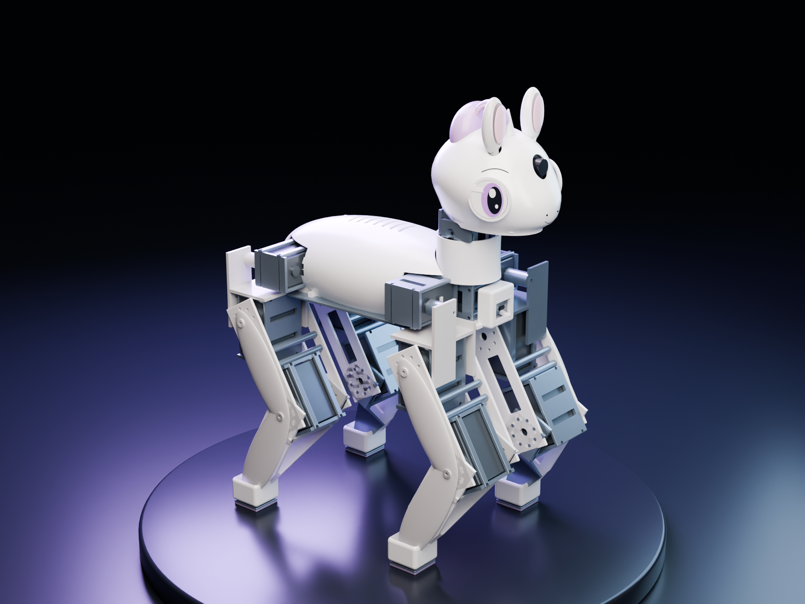
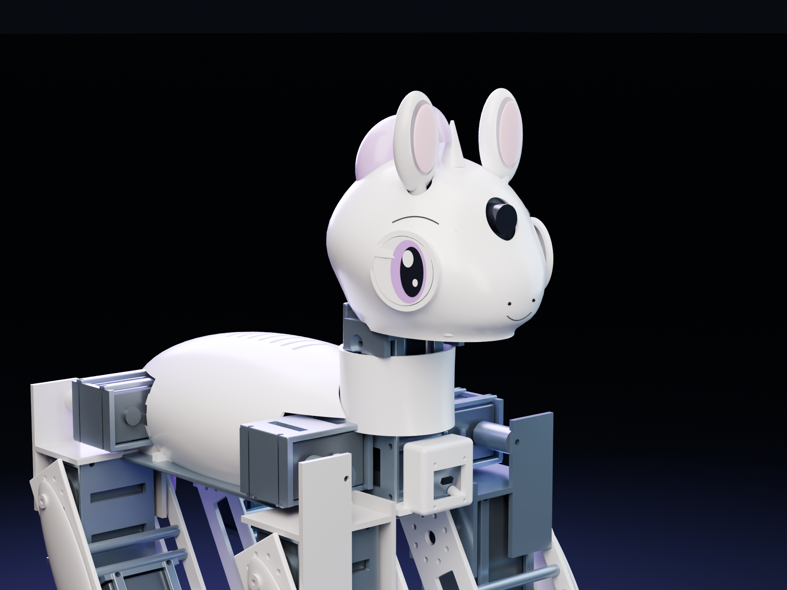
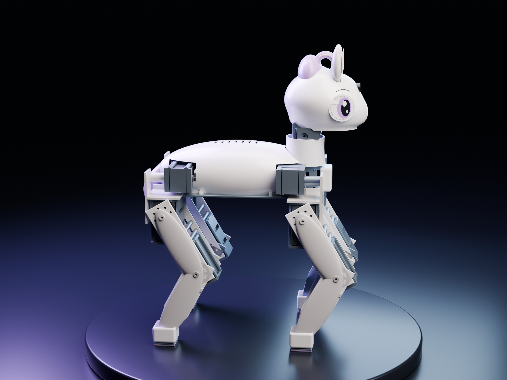

# Sweetybot2

> **V04 WITHDRAWN — do not fabricate.** A subsequent exact CAD motion audit found solid interference between moving thigh/shin plates, knee supports and the torso frame, already at the home pose. The software tests and simplified MuJoCo standing checks did not validate those surfaces. [Mechanical failure report](reports/mechanical_gate.json). The leg/frame layout requires redesign.

**Inspired by [Sweetie Bot](https://github.com/sweetie-bot-project/sweetie_bot) and [Microduck](https://github.com/pollen-robotics/microduck).** Independent pony robot CAD and MuJoCo policy experiments.



**V04 hardware + learning candidate:** 8 SM105BL pitch/knee motors, 4 SM80BL roll motors, sampled torso IMU, four contact switches, chest 8×8 ToF and forehead RGB camera. Estimated assembled mass **5.06kg**, with a **6.07kg** design allowance. This is a digital prototype; motors, interfaces, thermal endurance and physical fits have not been bench-validated. **No trained v04 policy is released.**

| Head and camera | Profile |
|---|---|
|  |  |

[V04 build and limitations](docs/v04.md) · [BOM](docs/bom.md) · [Motor selection](docs/servo-selection.md) · [Wiring](docs/wiring.md) · [Digital validation](reports/v04_validation.json) · [Complete package](https://github.com/AlexWortega/Sweetybot2/releases/tag/v0.4.0-hardware-preview)

The current root CAD, MJCF/URDF, mass properties, motor limits and sensor observation encoder describe the same v04 candidate. Body 240×112×88mm; foot-centre track 164mm; 95/100mm leg segments; overall CAD envelope approximately 331×198×426mm. Load parts use 6061 aluminium; cosmetic shells use PETG and hoof tread TPU. Mass is computed from CAD volumes, catalogue motor masses and unweighed hardware allowances. It is not a scale measurement.

The actor now has **591 observations** (three 197-value frames): sampled IMU, encoders, commands/history, binary contact + health, and ToF + health. RGB is modelled for rendering/perception and is not an actor input. MuJoCo truth is used for rewards/evaluation. Old 165-input v02 checkpoints are rejected. Physical MCU firmware, device drivers and bus commissioning remain outstanding; the offline collector decoder and shared actor encoder are included.

Rewards add foot slip, work and overload penalties, valid forward-flight events for running, and recovery progress with sustained feet-supported standing. Tests reject jumping in place, inverted reward farming and invalid contact wires. Digital checks demonstrate static support and sensor/optimizer plumbing, **not learned running, recovery or arbitrary-terrain capability**.

## Historical v02 training preview


*17 October 2026, separate lighter v02 model: walking, running attempt and recovery attempt. Eight simulated seconds at 1×; no mid-episode resets. This GIF does not show v04 or establish successful running/self-righting. [Checkpoint manifest](renders/training_preview_20261017/manifest.json). Earlier approved v02 training remains separate from this redesign.*

[V02 release and preview weights](https://github.com/AlexWortega/Sweetybot2/releases/tag/v0.2.0-preview) · [V03 sensor/face candidate](designs/sensor-v03/README.md) · [Historical engineering reports](reports/legacy-v02)

## Rebuild and check

CAD uses Python 3.13 and `cadgen==0.7.21`; learning uses a separate Python 3.11/3.12 environment with `learning/requirements.txt`. Configure `CAD_PY` / `LEARNING_PY` in the Makefile for your interpreters. See [v04 rebuild instructions](docs/v04.md) for the ordered workflow.

```sh
make setup setup-learning
make cad model
make test simulate
```

Full STEP assemblies and per-part STL/STEP are under `cad/`; high-detail GLB is in the complete ZIP. Rebuild meshes after CAD changes. No physical assembly or motor purchase was performed. Before fabrication, validate a loaded joint, horn/bearing interfaces, power distribution, wiring faults and actual IMU/contact/ToF timing. Manufacturer rated points and the simulated I2t surrogate are not proven continuous thermal ratings.

The existing joystick player retains walk/run selection and recovery priority. It requires newly trained matching v04 checkpoints. A new training run uses a fresh output directory and independent held-out final seeds 4000000..4000099; never resume the v02 job with v04 source.
