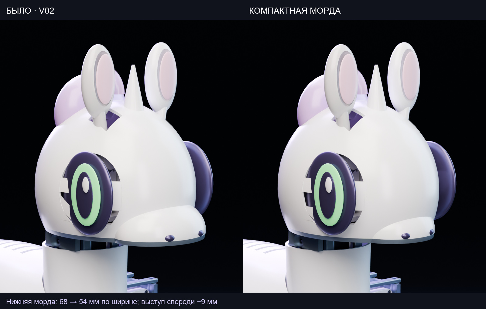
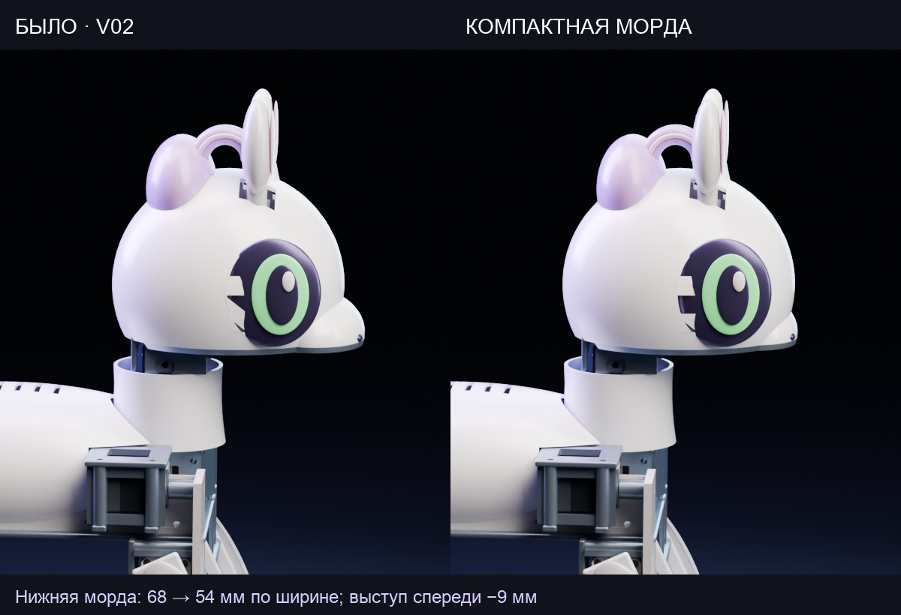

# Compact muzzle candidate

A separate editable CAD variant of revision 02. The main `config/robot.yaml`, saved MuJoCo model, existing training run and preview policies still refer to the original v02.

The camera positions, lenses and lighting placement are locked to the original studio render manifest. The nominal muzzle ellipsoid changes from centre `[73, 0, 14]`, radii `[27, 34, 22]` mm to centre `[68, 0, 14]`, radii `[23, 27, 20]` mm: width 68 → 54 mm, front extent 100 → 91 mm, height 44 → 40 mm. Nostril positions follow the smaller muzzle. The head, eyes, ears, horn, mounting locations and neck arrangement retain their original parameters.

The changed head shell and service hatch each remain one valid solid and fit the 220 mm print envelope. Their combined conservative solid-PETG mass estimate decreases by about 4.1 g. This is a CAD check; physical fit and policy transfer to the altered geometry have not been tested. [Detailed check](cad-check.json).

## Files

- [Candidate configuration](robot.yaml)
- [Candidate parametric factories](shapes.py)
- [Head shell STEP](STEP/head_shell.step) · [STL](STL/head_shell.stl)
- [Service hatch STEP](STEP/head_hatch.step) · [STL](STL/head_hatch.stl)
- [Portrait](../../renders/compact-muzzle/02-portrait.jpg) · [Profile](../../renders/compact-muzzle/03-violet-profile.jpg)

## Rebuild in a separate working copy

Make a separate checkout of this repository. In that copy, replace `config/robot.yaml` with this folder's `robot.yaml`, and `cad/src/lib/shapes.py` with this folder's `shapes.py`. Run `make setup` and `make cad` there to rebuild the CAD. Dynamics descriptions and all simulation checks must also be regenerated before using that changed model for policy evaluation; the existing v02 checkpoints are not validated for this variant.

For a matched comparison, the studio renderer accepts `--camera-manifest renders/studio/manifest.json --shots 02-portrait 03-violet-profile` after Blender's `--` separator.
