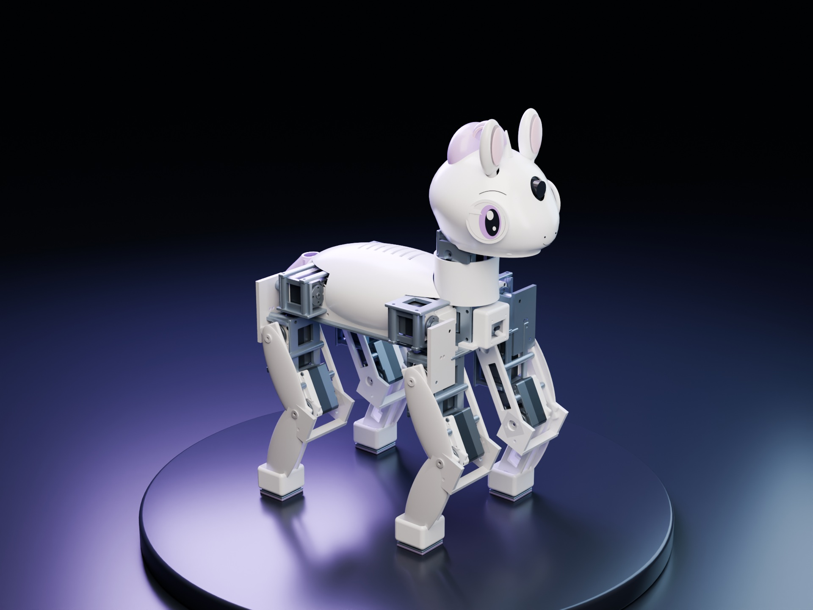
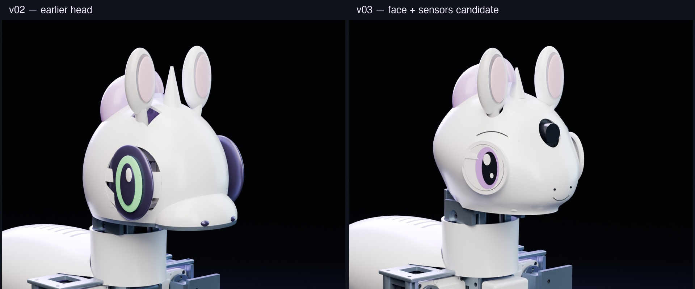

# Sweetybot2 v03 — face and sensor hardware candidate

Independent design inspired by [Sweetie Bot](https://github.com/sweetie-bot-project/sweetie_bot) and [Microduck](https://github.com/pollen-robotics/microduck).





This revision replaces the intersecting head/muzzle ellipsoids with a continuous loft, recessed round LCD eyes and a short smile. It adds camera, chest depth sensor, rigid torso IMU mounting and four contact-sensitive hoof assemblies. Small ear servos free space inside the skull. Nominal assembled mass is **2.712kg**, including solid-CAD material estimates and unweighed hardware allowances; the 20% contingency gives **3.255kg** for screening. Main-joint and ear screens pass conditionally, with a small transition margin; physical thermal behavior remains unverified.

**Editable digital candidate, not a fabricated or validated robot.** The accepted v02 CAD and running training source remain separate. v02 checkpoints are not validated for these mass, feet or actuator changes.

- [Sensor arrangement and wiring](docs/sensors.md)
- [Servo comparison and selection](docs/servo-selection.md)
- [Remaining mechanical checks](docs/validation-v03.md)
- [Parametric configuration](config/robot.yaml)
- [New geometry module](cad/src/lib/sensors_face.py)
- [Saved CAD checks](reports/cad_parts.json), [mass](reports/mass_budget.json), [static clearances](reports/new_clearances.json), [contact circuit checks](reports/sensor_contract.json)

The full desktop/release package contains individual STEP/STL, assembled STEP/GLB and source. Conservative purchased-part envelopes are labeled in the assembly; only the STS3250 uses the existing vendor STEP. Board and microservo horn fit must be checked against the exact purchased revisions.

Rebuild in a Python 3.13 environment with cadgen 0.7.21, NumPy and PyYAML (the parent project has uv.lock). Run from this candidate's root:

```sh
python -m scripts.build_cad
python -m scripts.check_cad
python -m scripts.reconcile_mass
python -m scripts.feasibility
python -m scripts.check_new_clearances
python -m scripts.check_sensor_contract
```

`hardware/contact_adc.py` is an offline reference decoder with debounce, stale-data rejection and open/short detection. MCU firmware, physical sensor drivers, calibration and estimator integration have not been implemented or verified. No additional training was launched for this hardware revision.
