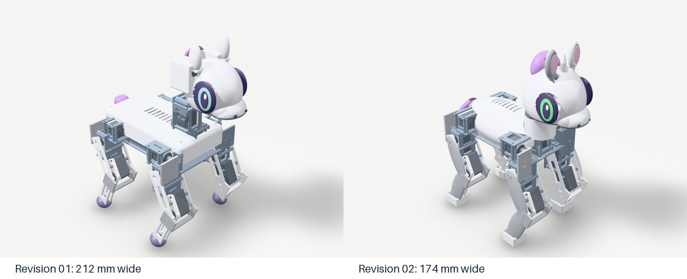

# Revision 02: closer to Sweetie Bot

The revision addresses the wide stance and visibly offset, stacked neck identified in the first delivery. The reference is the pony proportions in [Sweetie Bot's official gallery](https://sweetiebot.net/) and [Proto3 body images](https://sweetiebot.net/new-proto3-body/), while retaining the stronger STS3250 actuators and the existing power/control architecture.

| Property | Revision 01 | Revision 02 |
|---|---:|---:|
| Foot-centre track | 180mm | 140mm |
| Overall home width | 212mm | 174mm |
| Chassis deck width | 112mm | 100mm |
| Head pitch axis above torso datum | 87mm | 58mm |
| Pitch-servo case lateral centre | about -18.7mm | within 0.001mm of centreline |
| Ear motor packaging | External rectangular housings | Internal saddle |
| Body | Flat rectangular cover | Rounded chest/rump shell |
| Character details | Plain crest, cyan eyes, round feet | Horn, green eyes, pink/purple forelock, curved tail, hoof boots |

The stance changes through actual joint-origin updates, rather than visual mesh scaling. Increasing the roll-to-pitch drop to 42mm removes the former motor-envelope interference at the tested extreme roll angles. Raising stance height by the same amount retains the nominal leg bend and knee lever. Mass and COM/inertia allocations, both dynamics descriptions, CAD and gait tests are regenerated together.

The neck is centre-aligned by moving the pitch motor case along its own Y axis; this keeps the mathematical rotation axis unchanged. A symmetric two-cheek fork supports the head, with the yaw motor sunk into the chest. The ear cases fit inside the enlarged skull and use an integrated slotted saddle; bent stems separate the pinnae. Ear limits are ±0.25rad.

The update is still a digital prototype. Saved STEP checks and simulations do not establish real servo temperature, housing fit, printed-part strength, cable clearance or hardware position-loop behavior. Read [the mechanical review](mechanical_review.md), [simulation results](results.md) and [physical validation sequence](validation.md) before moving to a physical prototype.
