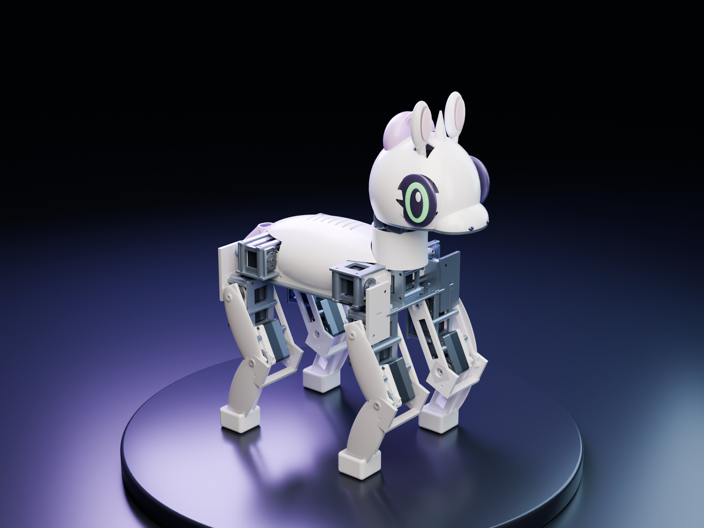
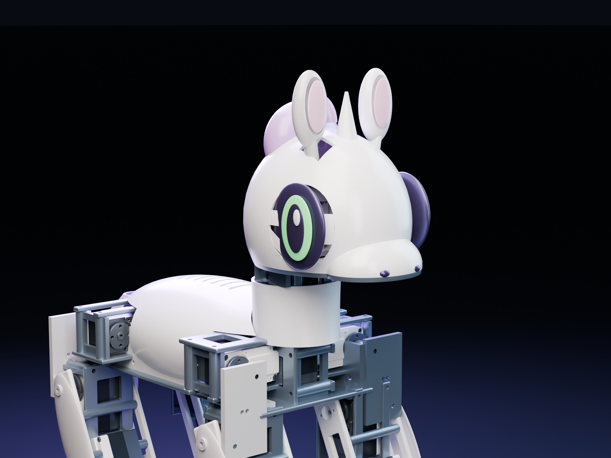
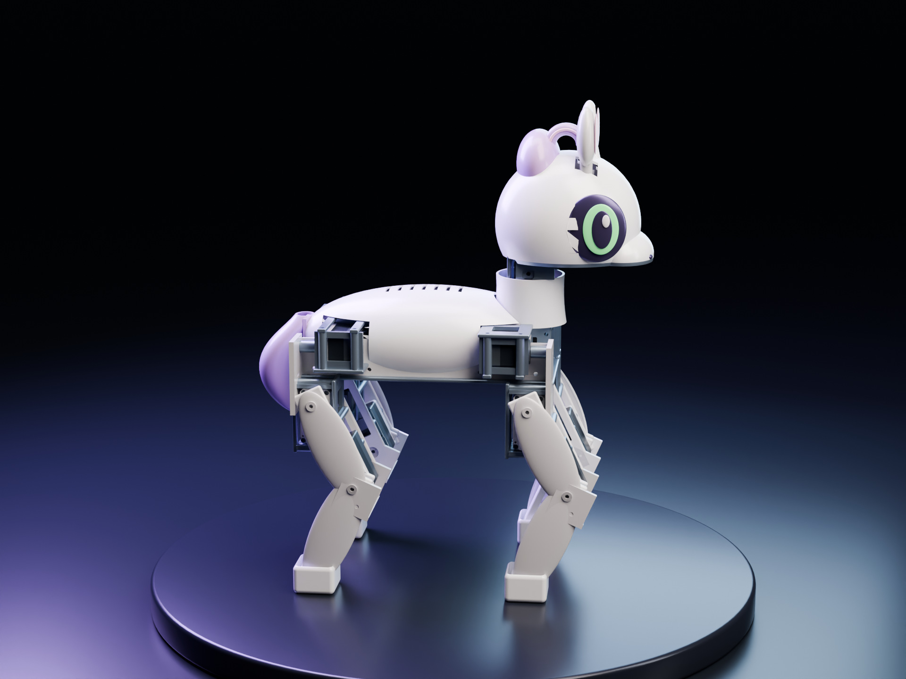

# Studio renders

The original v02 CAD assembly rendered in Blender 5.1.1 / Cycles at 1920 × 1440, 96 samples with denoising. Robot mesh coordinates, component placement and the home pose are unchanged. The scene adds a display plinth, a dark cyclorama, softboxes and a violet rim light. Material finishes are adjusted for the studio presentation; vendor CAD blue face markers are shown as graphite servo casings, and the existing green eye material has subtle emission.



[Original PNG](../renders/studio/01-midnight-hero.png)



[Original PNG](../renders/studio/02-portrait.png)



[Original PNG](../renders/studio/03-violet-profile.png)

## Reproduce

Extract the complete CAD ZIP from the [preview release](https://github.com/AlexWortega/Sweetybot2/releases/tag/v0.2.0-preview) into the project root so that `cad/GLB/assembly.glb` exists. Then run the locally installed Blender:

```sh
blender -b --factory-startup --python scripts/render_studio.py
```

On macOS with Blender in Applications:

```sh
/Applications/Blender.app/Contents/MacOS/Blender -b --factory-startup --python scripts/render_studio.py
```

Use `-- --preview` for a 960 × 720 draft, or `-- --out /path/to/output` to change the output folder. Metal is selected when available on macOS; CUDA is selected when available on other platforms, with CPU fallback. No training GPU is used by these local renders. [Manifest](../renders/studio/manifest.json) records the GLB SHA-256, mesh counts, original bounds, exact camera positions, lenses and render settings. The previews use the same digital model; they do not demonstrate hardware motion or policy performance.
